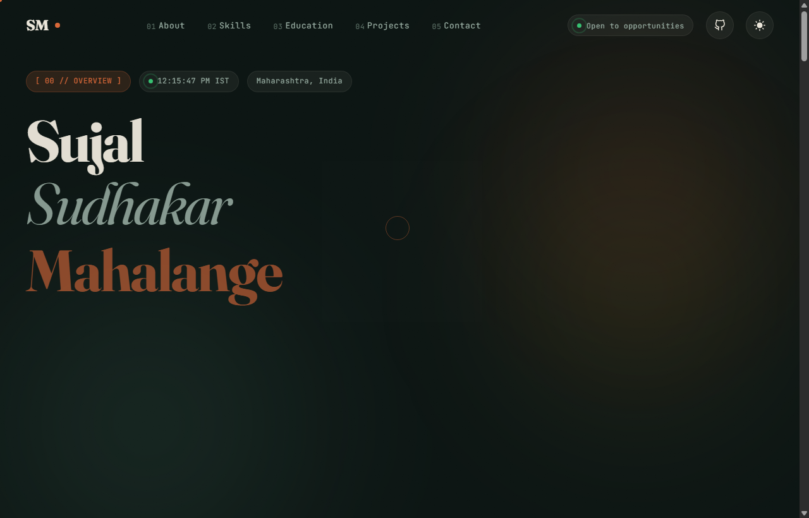
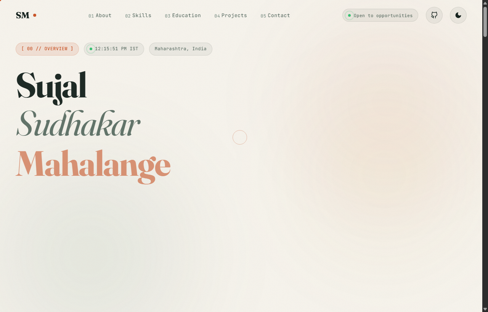
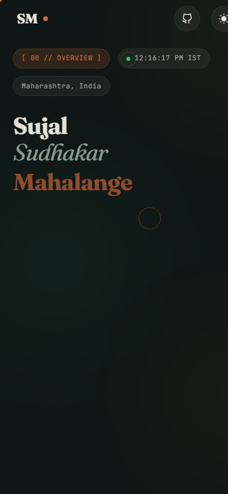
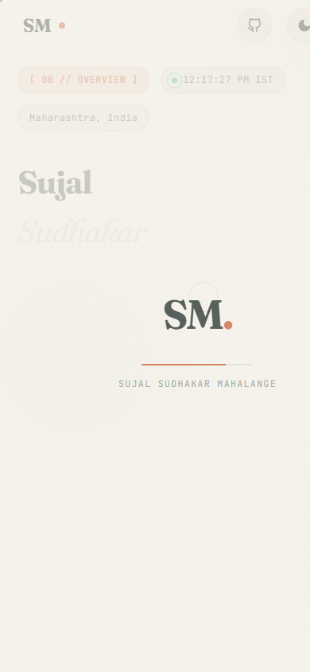

# Sujal Sudhakar Mahalange — Personal Portfolio

<p align="center">
  
</p>

<p align="center">
  <a href="https://github.com/Sujal-Mahalange/My-Portfolio/blob/main/LICENSE"></a>
  
  
  
  
  
</p>

<p align="center">
  <strong>Live Demo:</strong> <a href="https://sujal-mahalange.github.io/My-Portfolio/">https://sujal-mahalange.github.io/My-Portfolio/</a>
</p>

---

## 📖 Overview

A handcrafted, high-performance personal portfolio website built with pure semantic **HTML5**, modern **CSS3**, and vanilla **JavaScript**. Designed with an intentional **"glassy but grounded"** aesthetic that avoids AI design cliches (no purple neon or gradient text) in favor of deep bottle green / forest charcoal, warm parchment cream typography, terracotta accents, tactile SVG film grain, and subtle 3D card physics.

Engineered from the ground up to be **100% responsive across all device sizes** (from ultra-wide monitors down to 320px foldables and mobile viewports) with zero heavy framework bloat.

---

## 📸 UI Showcase

| Desktop (Dark Mode - Default) | Desktop (Light Mode) |
| :---: | :---: |
|  |  |

| Mobile (Dark Mode) | Mobile (Light Mode) |
| :---: | :---: |
|  |  |

---

## 👤 About Sujal Sudhakar Mahalange

- **Current Academic Program:** Master of Science in Information Technology (**M.Sc. IT**), 2nd Year (2025–2027), Deogiri College, Chhatrapati Sambhajinagar, Maharashtra, India.
- **Undergraduate Degree:** Bachelor of Science (**B.Sc.**), Graduated April 2025 with **A+ Grade**, Vasundhara College, Ghatnandur (Dr. Babasaheb Ambedkar Marathwada University).
- **Secondary & Higher Secondary:**
  - **HSC (12th):** Yogeshwari College, Ambajogai, 2022 (70%, Maharashtra State Board).
  - **SSC (10th):** Shri Kholeshwar Madhyamik Vidyalaya, Ambajogai, 2020 (78%, Maharashtra State Board).
- **Core Engineering Skills:** C, C++, Java, Android SDK, Python, Flask, FastAPI, HTML5, CSS3, JavaScript (ES6+), Node.js, SQL.
- **GitHub:** [https://github.com/Sujal-Mahalange](https://github.com/Sujal-Mahalange)
- **LinkedIn:** [https://www.linkedin.com/in/sujalmahalange-97820738b](https://www.linkedin.com/in/sujalmahalange-97820738b)
- **Email:** [sujalmahalange04@gmail.com](mailto:sujalmahalange04@gmail.com)

---

## ✨ Key Features & Technical Details

### 🎨 1. Visual Direction: "Glassy but Grounded"
- **Color Palette:**
  - **Dark Base:** `#0D1614` / `#121E1A` (rich deep bottle green / charcoal)
  - **Text:** `#EDE8DC` (warm cream / parchment off-white)
  - **Primary Accent:** `#D9693A` (terracotta / burnt orange)
  - **Secondary Accent:** `#E8A838` (warm saffron / amber)
  - **Muted Sage:** `#759A89` (subtle accent tint)
- **Light Mode Support:** Clean parchment paper background (`#F5F2EB`) with dark forest text and identical warm accents. Choice is remembered across reloads via `localStorage`.
- **Atmospheric Background:** Real SVG noise grain overlay (`assets/noise.svg`) blended over slow-drifting organic blurred gradient blobs, ensuring glassmorphic cards have visual substance to blur.
- **Typography:**
  - Headings: **Fraunces** (expressive, editorial serif with character).
  - Body: **Plus Jakarta Sans** (clean, readable geometric sans).
  - Metadata / Chips: **JetBrains Mono** (monospaced labels, dates, and codes).

### ⚡ 2. Dynamic Micro-Interactions
- **Hero Stagger Reveal:** Staggered entrance animation for title, role, and quick statistics via GSAP with pure CSS / IntersectionObserver fallback.
- **Live Local Time:** Real-time Indian Standard Time (IST) clock with updating seconds and active pulsating status beacon (`HH:MM:SS AM/PM IST • Maharashtra, India`).
- **Role Cycler:** Smooth rotating title banner (*Android Developer* → *Backend API Engineer* → *Systems & SQL Builder* → *IT Postgraduate Scholar*).
- **Custom Desktop Cursor:** Interactive two-piece cursor (terracotta dot + lerp-interpolated smooth ring) that expands on hover over cards, chips, and links. Automatically disabled on touch screens.
- **3D Card Tilt & Glare:** Cards calculate pointer position to produce physical 3D perspective rotation and dynamic specular light glare.
- **Click-to-Copy Email:** Instant copy-to-clipboard button with visual haptic feedback and a floating toast notification (*"Email copied to clipboard!"*).
- **Scroll Progress & Section Spy:** Top progress bar indicating scroll depth, with sticky glass header shrinking and highlighting the current section in view.
- **Education Timeline:** Vertical timeline showing educational progression from SSC (2020) through currently pursuing M.Sc. IT (2025–2027).
- **Skills Showcase:** 4 domain bento cards (*Languages*, *Mobile*, *Backend & APIs*, *Frontend & Web*) paired with an infinite marquee track.
- **Back to Top:** Smooth scrolling back to top button with hover animation.

### 📱 3. Multi-Device Compatibility & Accessibility
- **Breakpoints Covered:**
  - Extra Small / Foldables (`<= 360px`): Galaxy Fold outer screen, small Android devices.
  - Standard Mobile (`<= 480px`): iPhone SE, standard iOS/Android phones.
  - Tablet Portrait (`<= 768px`): iPads, Galaxy Tabs in portrait.
  - Tablet Landscape & Laptops (`<= 1024px`).
  - Wide Desktops (`1440px+`).
- **Touch Targets:** All interactive buttons and toggles are sized to at least **44×44px** to conform to WCAG 2.5.5 / 2.5.8 touch target guidelines.
- **Safe Area Insets:** Native support for notched devices and home indicators (`env(safe-area-inset-top)`, `env(safe-area-inset-bottom)`).
- **Prevent Auto-Zoom:** Mobile form inputs enforce `font-size: 16px` to prevent iOS Safari from zooming unexpectedly into the viewport upon focus.
- **Reduced Motion:** Full compliance with `@media (prefers-reduced-motion: reduce)` to disable animations for users with motion sensitivities.

---

## 📁 Directory Structure

```text
Portfolio/
├── index.html              # Semantic HTML5 markup, meta tags, and OpenGraph data
├── README.md               # Documentation, showcase, and deployment guide
├── LICENSE                 # Open-source MIT License
├── .gitignore              # Ignored system and temporary files
├── .vscode/
│   └── launch.json         # Chrome debugging configuration
├── css/
│   └── style.css           # Design tokens, glassmorphism, animations & media queries
├── js/
│   └── main.js             # IST clock, role cycler, 3D tilt, theme switcher & toast
└── assets/
    ├── noise.svg           # High-resolution procedural SVG grain texture
    ├── icons/              # Scalable vector assets
    └── screenshots/        # High-res preview screenshots
        ├── desktop-dark.png
        ├── desktop-light.png
        ├── mobile-dark.png
        └── mobile-light.png
```

---

## 🚀 Getting Started & Local Development

### 1. Clone the Repository
```bash
git clone https://github.com/Sujal-Mahalange/My-Portfolio.git
cd My-Portfolio
```

### 2. Run Locally
Because this project uses vanilla HTML, CSS, and JS with zero build steps or npm installations, you can open it directly in any browser:

**Using Python:**
```bash
python -m http.server 8080
```
Then navigate to: `http://localhost:8080`

**Using VS Code Live Server:**
1. Install the **Live Server** extension in Visual Studio Code.
2. Right-click `index.html` and select **"Open with Live Server"**.

---

## 🛠️ How to Customize

### 1. Change Colors & Accents
Open [css/style.css](css/style.css) and customize the CSS custom properties at the top:
```css
:root {
  --bg-base: #0D1614;               /* Primary background */
  --text-main: #EDE8DC;             /* Text color */
  --accent: #D9693A;                /* Change to your preferred accent color */
  --accent-hover: #E67A4D;
  --accent-secondary: #E8A838;      /* Saffron / secondary highlight */
  --glass-blur: 16px;               /* Frosted card blur */
}
```

### 2. Update Projects
Open [index.html](index.html) and navigate to `<!-- SECTION 04: PROJECTS -->`. Update the project titles, descriptions, technology badges, and repository URLs with your own.

### 3. Change Contact Details
- **Email:** Update in `index.html` and in `js/main.js` (`const SUJAL_EMAIL = 'your-email@example.com';`).
- **LinkedIn / GitHub:** Update the URLs in `index.html` header, contact section, and footer.

---

## 🌐 Deploying to GitHub Pages

1. Push your repository to GitHub:
   ```bash
   git add .
   git commit -m "feat: complete portfolio setup"
   git branch -M main
   git push -u origin main
   ```
2. In your GitHub repository, open **Settings** → **Pages** (under "Code and automation").
3. Under **Build and deployment > Source**, select **Deploy from a branch**.
4. Set branch to `main` and folder to `/(root)`, then click **Save**.
5. Your portfolio will be live at:
   `https://sujal-mahalange.github.io/My-Portfolio/`

---

## 📄 License

This project is licensed under the [MIT License](LICENSE) — free to use, modify, and distribute with attribution.

---

<p align="center">
  Designed & built with intention by <strong>Sujal Sudhakar Mahalange</strong> • 2026
</p>
